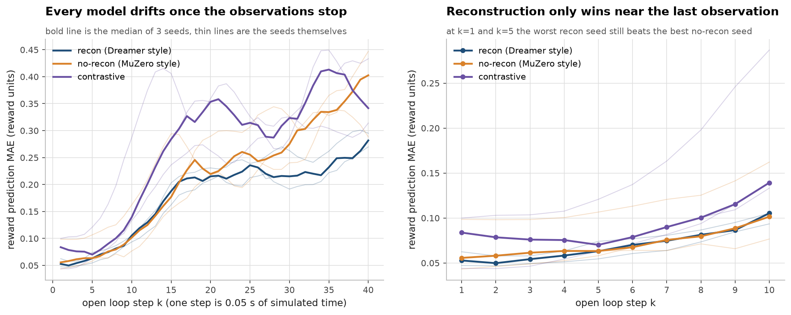
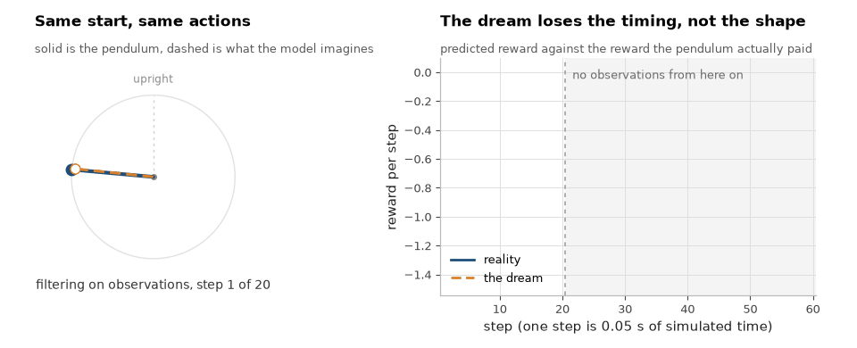
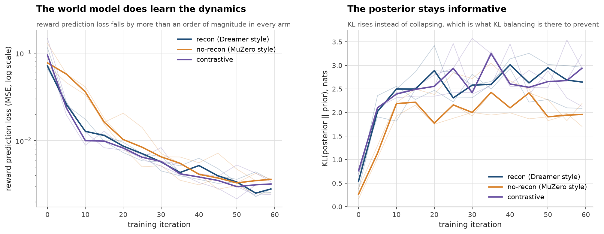
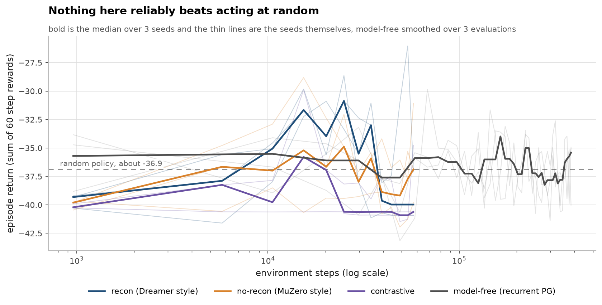

# world-model-from-scratch

[](https://github.com/aghasalim/world-model-from-scratch/actions/workflows/ci.yml)
[](https://www.python.org/)
[](LICENSE)
[](results/)
[](https://doi.org/10.5281/zenodo.23003689)

I built an RSSM from the Dreamer papers and trained an actor critic entirely in
imagination. I also ran an ablation to see if a world model needs to reconstruct
observations at all.

Half of this worked. The world model learns, and I got an answer on the
representation question, though a smaller one than I first published. The agent
trained inside it didn't work at the budget I planned for. At 57,600 environment
steps the best world model is level with a random policy and the other two are
below it. Giving them the 384,000 steps the model-free baseline got doesn't fix
that: no world model's median beats the baseline, and two of the nine runs go flat
early and never recover. None of them solves the task.
I kept the half that failed because of [`METHODOLOGY.md`](METHODOLOGY.md) rule 12,
and that's a big part of why this README looks the way it does.

I didn't use a GPU. The published results come from a rerun on an old 4 core i5
desktop, one thread per run. The main sweep took 61 minutes there, and the
384,000 step runs took 2.1 hours alongside it. Every number published
here is recomputed from the committed results by separate implementations in
`verify/`, and CI fails if any of them disagree.

## The task

It's a pendulum swing up where the agent only sees `cos(theta)` and `sin(theta)`.
The angular velocity is hidden.

That's why I wrote the environment by hand. If the agent could see velocity, it
would be a plain MDP that a feedforward policy can solve, and nothing would test
whether the model keeps track of state. Hiding velocity makes it a POMDP. Two
states with the same angle and opposite velocity give the same observation, and
the only way to tell them apart is to remember where the pendulum was. That's
what the recurrent state of an RSSM is for. There's also a test that checks the
ambiguity is really there.

## The representation ablation

Dreamer reconstructs observations and spends capacity on that. MuZero style
models don't reconstruct anything and only predict what control needs.
Contrastive methods are somewhere in between. I put all three behind one flag,
trained them the same way, and measured how far each can roll forward without
any observations.



Reward prediction MAE after filtering 20 steps and then predicting open loop,
median over 3 seeds:

| open loop step | recon (Dreamer) | no-recon (MuZero) | contrastive |
|---:|---:|---:|---:|
| 1 | 0.0527 | 0.0556 | 0.0837 |
| 5 | 0.0631 | 0.0633 | 0.0701 |
| 10 | 0.1053 | 0.1014 | 0.1392 |
| 15 | 0.1877 | 0.1769 | 0.2840 |
| 20 | 0.2152 | 0.2194 | 0.3535 |
| 40 | 0.2817 | 0.4026 | 0.3416 |

Up to twenty steps recon and no-recon are close and trade places. At one step the
three reconstruction seeds are 0.0472, 0.0527 and 0.0624. The three no-recon
seeds are 0.0432, 0.0556 and 0.0985, so the bands overlap. At k=5 the medians are
almost the same and the bands still overlap, with 0.0740 worst for recon against
0.0580 best for no-recon.

At k=10 recon spans 0.0934 to 0.1061 and no-recon spans 0.0766 to 0.1622, so
they overlap. Further out reconstruction pulls ahead on the median: 0.2817
against 0.4026 at k=40. Even there the seeds overlap at k=40 itself, and the only
horizons where every reconstruction seed beats every no-recon seed are 32 to 39.
Recon has degraded to 5.3 times its one step error by then and no-recon to 7.2
times.

Before I fixed the lambda returns, this table said reconstruction wins cleanly
for five steps and then stops mattering. After the rerun that's gone. What's left
is a hint that reconstruction drifts more slowly over long rollouts, with three
seeds and eight horizons behind it, which isn't enough for me to say the decoder
is worth it.



Both pendulums start from the same twenty observed steps and get the same action
sequence. After step 20 the model gets nothing. It keeps the shape of the swing
but loses the timing. This is the reconstruction model at seed 0, on the episode
whose open loop error is the median of the 128 the numbers above are averaged
over.

Contrastive has the worst median at every horizon up to 38 steps, and that
surprised me. Its InfoNCE
term only asks the latent to pick out which observation in the batch it belongs
to. With a two dimensional observation on the unit circle that's an easy task,
so the latent doesn't have to encode much. I'd guess it would do better with a
richer observation space.

## The model itself learns



From the median first iteration loss to the median last one, reward prediction
loss falls by 25 times for recon, 21 times for no-recon and 30 times for
contrastive. The KL between posterior and prior goes up as the posterior starts
carrying information, which is what I expected.

## What did not work

| method | return | range over seeds | env steps |
|---|---:|---|---:|
| recon (Dreamer style) | −39.97 | −40.9 to −37.1 | 57,600 |
| no-recon (MuZero style) | −36.89 | −39.8 to −31.1 | 57,600 |
| contrastive | −40.62 | −40.9 to −34.8 | 57,600 |
| model-free (recurrent PG) | −40.66 | −43.2 to −38.1 | 48,960 |
| model-free, run out to 384,000 steps | −35.08 | −40.0 to −34.9 | 384,000 |

A random policy scores about −36.9, measured over 200,000 episodes by
`verify/pendulum`. The best world model, no-recon at −36.89, is level with that,
and the other two are below it. So the sample efficiency result I set out to show
doesn't reproduce. Put plainly, at 57,600 environment steps none of the three
world models has learned anything useful. No-recon is 3.8 above the model-free
baseline's −40.66, but its seed range overlaps the baseline's.

The model-free arm is evaluated every ten iterations and never lands exactly on
57,600 steps. Its row above is the nearest evaluation below that, at 48,960. The
next one up, at 58,560 steps, has a median of −35.89, which beats every world
model final here. Picking a different evaluation point moves the comparison more
than picking a different method does, so it points to the same conclusion.

When I ran that baseline out to 384,000 steps it reached −35.08. That's better
than every final in the table above. Tuning changed things without fixing them,
in runs I did before the lambda return fix. Raising the imagination
horizon from 15 to 40 took the best run from −40.1 to −30.1, and then the runs oscillate: one reaches −30.6 and falls back to −39.4.

### Given the same 384,000 steps

The comparison above isn't fair to the world models. I ran the model-free
baseline out to 384,000 environment steps but stopped them at 57,600. So I reran
each one for 400 iterations, 384,000 steps, and left every other setting the same ([`results/long-summary.csv`](results/long-summary.csv),
[`results/long-curves.csv`](results/long-curves.csv)).

| method, at 384,000 steps | seed 0 | seed 1 | seed 2 | median |
|---|---:|---:|---:|---:|
| recon (Dreamer style) | −31.50 | −39.97 | −40.91 | −39.97 |
| no-recon (MuZero style) | −36.57 | −31.46 | −39.55 | −36.57 |
| contrastive | −33.24 | −39.68 | −40.59 | −39.68 |
| model-free (recurrent PG) | −40.03 | −34.94 | −35.08 | −35.08 |

More experience doesn't rescue the world models. No median here beats the
model-free baseline's −35.08, and only no-recon's is level with the random
policy's −36.9. Each model has one seed that beats both, recon at −31.50, no-recon
at −31.46 and contrastive at −33.24. The other runs end at or below random, and
two of the recon runs go flat by about 44,000 steps and never move again.

Before the lambda return fix this table said every world model beats random and
the baseline here, apart from one contrastive run. The policy was learning from
returns that bootstrapped the last step off the wrong state, and after fixing that
the 384,000 step result I had published doesn't hold. So the sample efficiency
result isn't there at either budget.

Two more things. None of these returns comes
close to holding the pendulum up, and the curves still wander. The best return any
world model hit during training was −18.10, on a seed that finished at −31.50.
Also, counting per environment step isn't the same as counting compute. On the i5,
one thread each, a 384,000 step world model run took 2,345 to 2,711 s, and the
model-free one took about 44 s.



Longer version in [notes/METHODS.md](notes/METHODS.md#what-did-not-work).

## What the checks caught

The checks found two mistakes. I had quoted the random policy baseline as about
−38 everywhere, including the dashed line every learning curve is compared to. I'd
never actually measured it by itself. Two separate reimplementations of the
environment, 200,000 episodes each, give −36.87 and −36.85, so it's now −36.9.
That made the negative result stronger, since at 57,600
environment steps every world model in that run was below random.

The second one is smaller. I had labelled the model-free row of the return table
57,600 environment steps. But the model-free arm is only evaluated every ten
iterations, and its nearest evaluation is 48,960. The row says 48,960 now. I also
mention what the next evaluation up gives, because only showing the one below
makes the world models look better.

## What I got wrong

I picked the imagination horizon by copying a number instead of thinking about
the task. Fifteen steps is standard in the Dreamer papers, but their control
suites use different timesteps. At dt=0.05 that is 0.75 seconds, and a swing up
takes several. So I was asking the agent to plan over a window where the right
action actually looks bad. It took me three rounds of debugging before I
converted 15 steps into seconds.

I also left out the target critic because DreamerV2 describes it as a
stabilisation detail. Putting it back didn't fix the oscillation either.

Longer version in [notes/METHODS.md](notes/METHODS.md#what-i-got-wrong).

## Running it

```bash
python -m venv .venv && source .venv/bin/activate
pip install -r requirements.txt
```

```bash
python -m pytest tests/ -q
```

```bash
python -m experiments.main --seeds 0 1 2 --iters 60 --imag-horizon 40 --actor-lr 1e-3 --eval-every 5
```

```bash
python -m bench.figures
```

The sweep takes about ten minutes on an M4 CPU and writes `results/*.csv`. The
three static figures only read those files and never re-run an experiment. The
animation is different, because a summary file can't hold a drifting rollout. It
retrains the seed 0 world model, which takes about a minute, and won't write
itself unless its open loop error still matches the committed `open-loop.csv`
exactly.

[notes/FLAGS.md](notes/FLAGS.md) goes through that command flag by flag and
says what each arm cost.

## What is where

```
wm/envs.py       the POMDP pendulum, written directly, no simulator dependency
wm/rssm.py       deterministic GRU path, stochastic latent, KL balancing
wm/agent.py      actor critic in imagination, lambda returns, target critic
wm/modelfree.py  recurrent policy gradient baseline, same architecture
wm/buffer.py     sequence replay
experiments/     the sweep and the open loop measurement
verify/          the same numbers recomputed independently
tests/           22 tests
```

## Reading

- **Hafner, Lillicrap, Fischer, Villegas, Ha, Lee, Davidson. Learning Latent Dynamics for Planning from Pixels. ICML 2019.** [arXiv:1811.04551](https://arxiv.org/abs/1811.04551) PlaNet, and the RSSM's split of the latent into deterministic and stochastic parts.
- **Hafner, Lillicrap, Ba, Norouzi. Dream to Control: Learning Behaviors by Latent Imagination. ICLR 2020.** [arXiv:1912.01603](https://arxiv.org/abs/1912.01603) Dreamer: backpropagating the actor through imagined trajectories.
- **Hafner, Lillicrap, Norouzi, Ba. Mastering Atari with Discrete World Models. ICLR 2021.** [arXiv:2010.02193](https://arxiv.org/abs/2010.02193) DreamerV2. KL balancing, lambda returns and the target critic all come from here.
- **Schrittwieser, Antonoglou, Hubert et al. Mastering Atari, Go, Chess and Shogi by Planning with a Learned Model. Nature 2020.** [arXiv:1911.08265](https://arxiv.org/abs/1911.08265) MuZero: the no-reconstruction position this ablation tests.
- **Laskin, Srinivas, Abbeel. CURL: Contrastive Unsupervised Representations for Reinforcement Learning. ICML 2020.** [arXiv:2004.04136](https://arxiv.org/abs/2004.04136) The contrastive arm.
- **Kaelbling, Littman, Cassandra. Planning and Acting in Partially Observable Stochastic Domains. AI 1998.** Why hiding velocity changes the problem, not just its difficulty.

## License

MIT, see [LICENSE](LICENSE).
